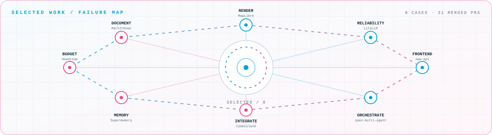

I work on AI systems at the point where the happy path stops. The useful bugs are usually small: a false boolean dropped before a database write, a translated DOM node that React no longer owns, or a memory graph that silently hides half its data.

My public work is 31 merged pull requests across 16 other projects, mostly in agent runtimes, memory, MCP, rendering, and document pipelines. I prefer a narrow patch with a reproduced failure over a broad refactor with a plausible story.

## Selected work

<picture>
  <source media="(prefers-color-scheme: dark)" srcset="assets/closed-loop-dark.svg">
  <source media="(prefers-color-scheme: light)" srcset="assets/closed-loop-light.svg">
  
</picture>

Eight merged changes, chosen because each one closes a concrete failure mode. Together: **+3,664 / -244 across 45 files**.

| Failure mode | Project | What changed |
| --- | --- | --- |
| A non-interactive map marker announces itself as a button | [MapLibre GL JS #7918](https://github.com/maplibre/maplibre-gl-js/pull/7918) | Uses `role="img"` until a marker actually becomes interactive; preserves explicit roles. |
| `blocked: false` disappears before a customer update reaches the database | [LiteLLM #34696](https://github.com/BerriAI/litellm/pull/34696) | Keeps explicit booleans through the default-value filter, so an admin can unblock a customer. |
| Browser translation mutates React-owned text and turns a successful API call into a false 500 | [new-api #5963](https://github.com/QuantumNous/new-api/pull/5963) | Marks the React roots as non-translatable; the reproduced API-key flow succeeds again. |
| Model routing is scattered across five orchestration call sites | [open-multi-agent #286](https://github.com/open-multi-agent/open-multi-agent/pull/286) | Adds one deterministic routing policy shared by worker, delegation, short-circuit, coordinator, and synthesis paths. |
| An agent runtime cannot install or repair its coding-agent extension | [CodeIsland #197](https://github.com/wxtsky/CodeIsland/pull/197) | Adds first-class pi and Oh My Pi install, status, repair, disable, and uninstall lifecycles. |
| A memory graph shows a subset without saying so or offering a next page | [Supermemory #1032](https://github.com/supermemoryai/supermemory/pull/1032) | Adds pagination metadata, an honest `showing N of total` summary, and incremental loading. |
| A daily budget counts one agent and ignores every other local agent | [Headroom #8](https://github.com/llm-learner/headroom/pull/8) | Pools budget across Codex, Claude, OpenCode, Antigravity, and WorkBuddy with per-agent adapters and a shared ledger. |
| An RFC 5987 `filename*=` header loses the real filename | [MarkItDown #2045](https://github.com/microsoft/markitdown/pull/2045) | Prefers the extended filename and adds regression coverage for response conversion. |

## Selected case notes

**LiteLLM #34696 - the update returned 200 and changed nothing.**

The endpoint accepted `blocked: false`, then dropped it while filtering default values. I kept explicitly supplied booleans, added a regression test for the database payload, and verified the before/after flow against two live proxy workers sharing Postgres and Redis.

**new-api #5963 - a frontend crash reported as a backend 500.**

Google Translate wrapped React-managed text nodes in `` elements. On API-key creation, React tried to remove a node the translator had replaced, raised `removeChild` `NotFoundError`, and rendered the error page while `/api/token/` still returned 200. I reproduced the DOM mutation, marked both frontend roots as non-translatable, and confirmed the same flow completed without the React error.

**Headroom #8 - a budget built on one agent's history.**

The meter read Codex prompt history only. I added adapters for four more local agents, migrated the ledger in place, normalized their hook payloads, and kept one shared daily cap. The implementation includes cached discovery, per-session turn sequencing, and 74 passing tests.

## Things I build

| Project | Why it exists |
| --- | --- |
| [Cognitive Terrain](https://cognitive-terrain.eriri-blog.workers.dev) · [source](https://github.com/cat0825/cognitive-terrain) | A local-first 3D map of a note collection. Semantic similarity sets position, explicit cognitive state sets elevation, and every visual claim opens back to its source field and formula version. |
| [Research Hub](https://research-hub-wine.vercel.app) · [source](https://github.com/cat0825/research-hub) | A Next.js and Supabase knowledge hub for publishing resources and exploring shared knowledge graphs. |
| [cmdaudit](https://github.com/cat0825/cmdaudit) · [source](https://github.com/cat0825/cmdaudit) | A command-level audit workbench for AI coding-agent sessions: duration, exit code, failure reason, retry loops, and evidence-backed candidates for follow-up experiments. |

## How I work

- **Reproduce the failure before patching it.** A bug report becomes useful when the failing path, expected result, and observable evidence are written down.
- **Keep the patch where the failure lives.** Small changes are easier to review, revert, and trust.
- **Leave proof.** Tests, type checks, builds, live smoke runs, and before/after traces belong in the pull request.
- **Disclose AI assistance.** Most of this work was prepared with coding agents. The reproduction and verification still have to be real.

## More

- [All merged pull requests authored by me](https://github.com/pulls?q=is%3Apr+author%3Acat0825+is%3Amerged)
- [GitHub profile](https://github.com/cat0825)

Counts refreshed 2026-10-17 from GitHub public search and the contribution calendar. Selected PR diff totals were read from the GitHub API.
